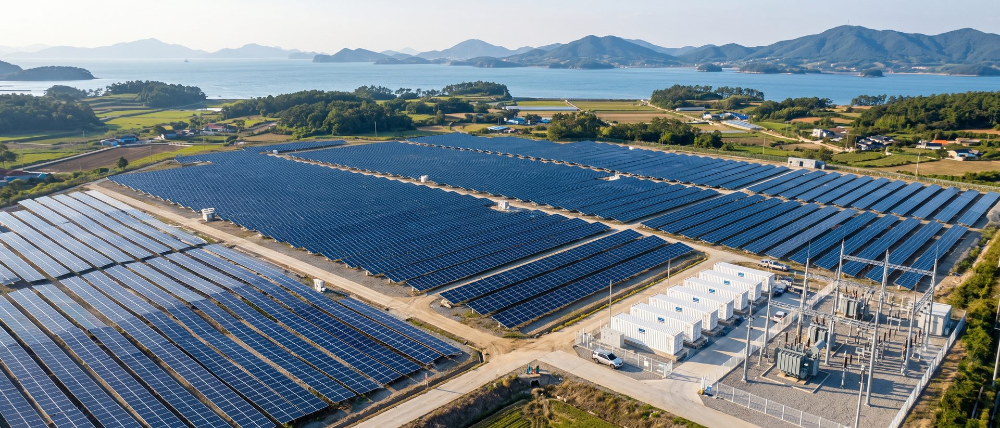

# 이미지 슬롯 관리표

홈페이지의 모든 이미지 자리는 `<figure class="ph" data-slot="…">` 로 표시되어 있습니다. 실제 사진을 받으면 **해당 figure 안에 ``만 넣으면** 자리표시 그래픽·라벨이 자동으로 사라지고 같은 비율로 채워집니다. 레이아웃은 바뀌지 않습니다.

```html
<figure class="ph" data-slot="portfolio-case-01" ...>
  <picture>
    <source type="image/avif" srcset="../../assets/img/portfolio/portfolio-case-01.avif">
    <source type="image/webp" srcset="../../assets/img/portfolio/portfolio-case-01.webp">
    
  </picture>
</figure>
```

## 규칙

- 파일명 = 슬롯명 (`slot` 값). 폴더는 아래 표의 `assets/img/<분류>/`.
- 시공 실적·시공 사례 사진은 **해당 현장에서 촬영한 실제 사진만** 사용합니다. 다른 현장 사진, 스톡·AI 이미지를 실적처럼 쓰지 않습니다.
- AI/스톡 콘셉트 이미지를 임시로 쓸 경우 캡션에 “콘셉트 이미지”를 명시하고, 실적·사례·제품 페이지에는 쓰지 않습니다.
- 제품 사진은 제조사 자료 사용 허가를 확인한 뒤 사용합니다. 제조사 로고는 넣지 않습니다(대리점·공식 파트너로 오해 방지).
- 비율은 슬롯별로 고정입니다. 다른 비율의 원본은 중앙 기준으로 잘리니 표의 권장 구도를 참고해 촬영/선택해 주세요.
- 권장 규격: 긴 변 1600px 이상, JPG 원본 + WebP/AVIF 변환본, 파일당 300KB 이하(WebP 기준).

## 구분

- **real** — 실제 사진 필요 (실적·증빙 — 임의 생성/타 현장 사진 사용 금지)
- **temp** — 임시 이미지 자리 (콘셉트 이미지 가능, 반드시 “콘셉트” 표기)
- **product** — 제품 사진 필요 (제조사 자료 사용 허가 확인)
- **map** — 지도 연동 예정

## 슬롯 목록 (37개)

| 슬롯 | 페이지 | 대상 | 비율 | 구분 | 권장 구도 · 비고 | 저장 위치 |
|---|---|---|---|---|---|---|
| `about-history-01` | /about/history/ | 사옥 · 사무실 사진 | 4:3 | real | 외관 또는 내부 1장 | `assets/img/company/about-history-01.*` |
| `about-location-01` | /about/location/ | 카카오맵 삽입 자리 | 16:9 | map | <div id="map"> + 카카오 개발자 앱 키(JavaScript 키) · 위치 표시 및 길찾기 링크 | `assets/img/company/about-location-01.*` |
| `about-mission-01` | /about/mission/ | 사무실 · 대표 현장 사진 | 4:3 | real | 가로형 1장, 1600px 이상 | `assets/img/company/about-mission-01.*` |
| `business-consulting-01` | /business/consulting/ | 상담 · 현장 검토 사진 | 21:9 | temp | 가로형 현장 사진 1장, 1920px 이상 | `assets/img/business/business-consulting-01.*` |
| `business-ess-01` | /business/ess/ | 컨테이너형 ESS 설치 현장 | 21:9 | temp | 가로형 현장 사진 1장, 1920px 이상 | `assets/img/business/business-ess-01.*` |
| `business-01` | /business/ | 공장 지붕 태양광 현장 | 4:3 | temp |  | `assets/img/business/business-01.*` |
| `business-02` | /business/ | 발전소 · 시공 현장 | 4:3 | temp |  | `assets/img/business/business-02.*` |
| `business-03` | /business/ | 상담 · 컨설팅 이미지 | 4:3 | temp |  | `assets/img/business/business-03.*` |
| `business-04` | /business/ | 컨테이너형 ESS 현장 | 4:3 | temp |  | `assets/img/business/business-04.*` |
| `business-plant-01` | /business/plant/ | 태양광 발전소 시공 현장 | 21:9 | temp | 가로형 현장 사진 1장, 1920px 이상 | `assets/img/business/business-plant-01.*` |
| `business-roof-01` | /business/roof/ | 공장 지붕 태양광 현장 전경 | 21:9 | temp | 가로형 현장 사진 1장, 1920px 이상 | `assets/img/business/business-roof-01.*` |
| `portfolio-case-01` | /portfolio/case/ | 고흥 태양광 발전소 · ESS 연계 전경 | 21:9 | real | 드론 · 전경 사진 1장, 1920px 이상 | `assets/img/portfolio/portfolio-case-01.*` |
| `portfolio-case-02` | /portfolio/case/ | 시공 과정 사진 | 4:3 | real |  | `assets/img/portfolio/portfolio-case-02.*` |
| `portfolio-case-03` | /portfolio/case/ | ESS 컨테이너 설치 | 4:3 | real |  | `assets/img/portfolio/portfolio-case-03.*` |
| `portfolio-case-04` | /portfolio/case/ | 준공 후 모습 | 4:3 | real |  | `assets/img/portfolio/portfolio-case-04.*` |
| `portfolio-case-05` | /portfolio/case/ | 「광양 산단 공장」 지붕 태양광 전경 | 21:9 | real | 드론 · 전경 사진 1장, 1920px 이상 | `assets/img/portfolio/portfolio-case-05.*` |
| `portfolio-case-06` | /portfolio/case/ | 시공 전 지붕 | 4:3 | real |  | `assets/img/portfolio/portfolio-case-06.*` |
| `portfolio-case-07` | /portfolio/case/ | 시공 과정 | 4:3 | real |  | `assets/img/portfolio/portfolio-case-07.*` |
| `portfolio-case-08` | /portfolio/case/ | 준공 후 모습 | 4:3 | real |  | `assets/img/portfolio/portfolio-case-08.*` |
| `portfolio-etc-01` | /portfolio/etc/ | 현장 사진 | 4:3 | real |  | `assets/img/portfolio/portfolio-etc-01.*` |
| `portfolio-etc-02` | /portfolio/etc/ | 현장 사진 | 4:3 | real |  | `assets/img/portfolio/portfolio-etc-02.*` |
| `portfolio-etc-03` | /portfolio/etc/ | 현장 사진 | 4:3 | real |  | `assets/img/portfolio/portfolio-etc-03.*` |
| `portfolio-01` | /portfolio/ | 현장 사진 | 4:3 | real |  | `assets/img/portfolio/portfolio-01.*` |
| `portfolio-02` | /portfolio/ | 현장 사진 | 4:3 | real |  | `assets/img/portfolio/portfolio-02.*` |
| `portfolio-03` | /portfolio/ | 현장 사진 | 4:3 | real |  | `assets/img/portfolio/portfolio-03.*` |
| `portfolio-04` | /portfolio/ | 현장 사진 | 4:3 | real |  | `assets/img/portfolio/portfolio-04.*` |
| `portfolio-05` | /portfolio/ | 현장 사진 | 4:3 | real |  | `assets/img/portfolio/portfolio-05.*` |
| `portfolio-06` | /portfolio/ | 현장 사진 | 4:3 | real |  | `assets/img/portfolio/portfolio-06.*` |
| `product-ess-01` | /product/ess/ | 배터리 랙 사진 | 4:3 | product | 제품 사진 · 제조사 자료 사용 허가 확인 | `assets/img/product/product-ess-01.*` |
| `product-ess-02` | /product/ess/ | PCS 사진 | 4:3 | product | 제품 사진 · 제조사 자료 사용 허가 확인 | `assets/img/product/product-ess-02.*` |
| `product-ess-03` | /product/ess/ | 컨테이너형 ESS 사진 | 4:3 | product | 제품 사진 · 제조사 자료 사용 허가 확인 | `assets/img/product/product-ess-03.*` |
| `product-solar-01` | /product/solar/ | 진코솔라 모듈 사진 | 4:3 | product | 제품 사진 · 제조사 자료 사용 허가 확인 | `assets/img/product/product-solar-01.*` |
| `product-solar-02` | /product/solar/ | 신성이엔지 모듈 사진 | 4:3 | product | 제품 사진 · 제조사 자료 사용 허가 확인 | `assets/img/product/product-solar-02.*` |
| `product-solar-04` | /product/solar/ | OCI 인버터 사진 | 4:3 | product | 제품 사진 · 제조사 자료 사용 허가 확인 | `assets/img/product/product-solar-04.*` |
| `product-solar-05` | /product/solar/ | 다스테크 인버터 사진 | 4:3 | product | 제품 사진 · 제조사 자료 사용 허가 확인 | `assets/img/product/product-solar-05.*` |
| `support-news-01` | /support/news/ | 보도 · 행사 사진 | 4:3 | real | 준공식 · 협약식 등 | `assets/img/news/support-news-01.*` |
| `support-news-02` | /support/news/ | 보도 · 행사 사진 | 4:3 | real |  | `assets/img/news/support-news-02.*` |

## 현재 사용 중인 시안용 이미지

- 36개 슬롯 전부 **시안용 임시 이미지**(스톡·AI·샘플 화면)가 들어 있습니다. 출처는 `CREDITS.md`. 실제 사진으로 교체할 때는 같은 파일명(JPG/WebP/AVIF)으로 덮어쓰고, 해당 `<figure>`의 `data-chip="시안용 이미지"`를 지우면 칩이 사라집니다. 실적·제품 페이지의 시안 이미지는 실제 자료로 반드시 교체해야 합니다.

## 현재 사용 중인 실제 이미지

- 홈 히어로: `assets/hero-solar*.{jpg,webp,avif}` — Unsplash 스톡 사진(출처 불필요 라이선스)입니다. 정수 E&G의 실제 현장이 아니므로 **자사 현장 사진으로 교체를 권장**합니다. 교체 시 같은 파일명으로 덮어쓰면 됩니다.
